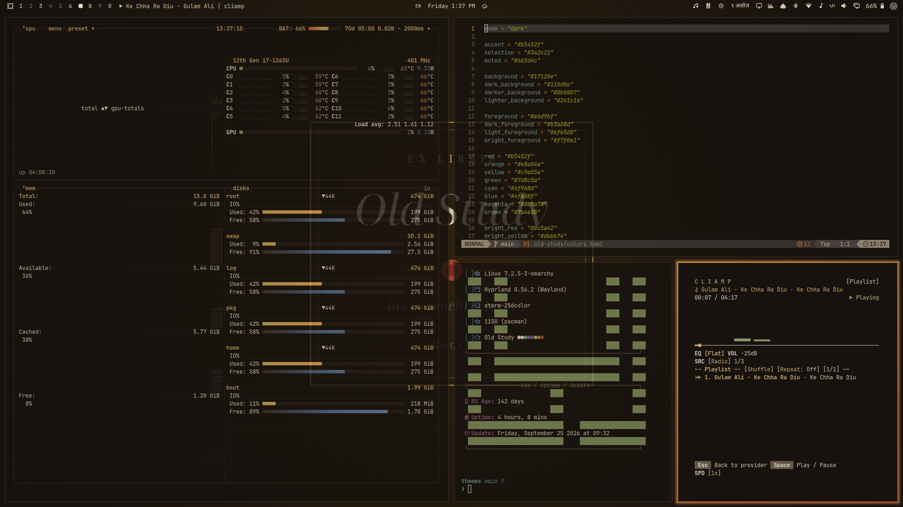

# Old Study



Candlelight, leather books and ink on a rainy afternoon in an old library. Walnut, parchment, brass and oxblood.

## Install

```bash
omarchy theme install https://github.com/sumdahl/omarchy-old-study-theme
```

## Palette

| Role | Color |
|---|---|
| background | `#17120e` |
| foreground | `#e6d9bf` |
| accent | `#b5452f` |
| red | `#b5452f` |
| orange | `#e8a04a` |
| yellow | `#c9a55a` |
| green | `#7d8c5a` |
| cyan | `#6f9a8d` |
| blue | `#4f6d8f` |
| magenta | `#8a5a78` |
| brown | `#7a4e30` |

## Wallpapers

Three are designed for this theme and five are the original paintings, shown as they are.

- `00-ex-libris.jpg`: original, made for this theme.
- `01-night-school.jpg`: Gerrit Dou, *The Night School*, 1663, public domain.
- `02-magdalen-smoking-flame.jpg`: original frame, made for this theme, around Georges de La Tour, *The Magdalen with the Smoking Flame*, c. 1640, public domain.
- `03-rich-fool.jpg`: Rembrandt, *The Parable of the Rich Fool*, 1627, public domain.
- `04-blacksmiths-shop.jpg`: Joseph Wright of Derby, *The Blacksmith's Shop*, 1771, public domain.
- `05-hevelius-atlas.jpg`: original, made for this theme, with the Ursa Major plate from Johannes Hevelius, *Firmamentum Sobiescianum*, 1690, public domain.
- `06-claesz-vanitas.jpg`: Pieter Claesz, *Still Life with a Self-portrait*, 1628, public domain.
- `07-collier-vanitas.jpg`: Evert Collier, *Vanitas Still Life*, 1662, The Metropolitan Museum of Art, CC0.

## License

The theme files are MIT licensed. Each wallpaper keeps the license listed above.
